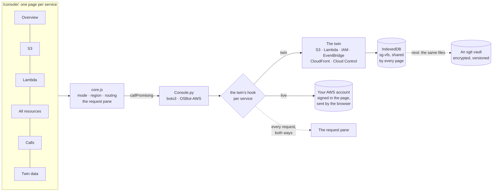
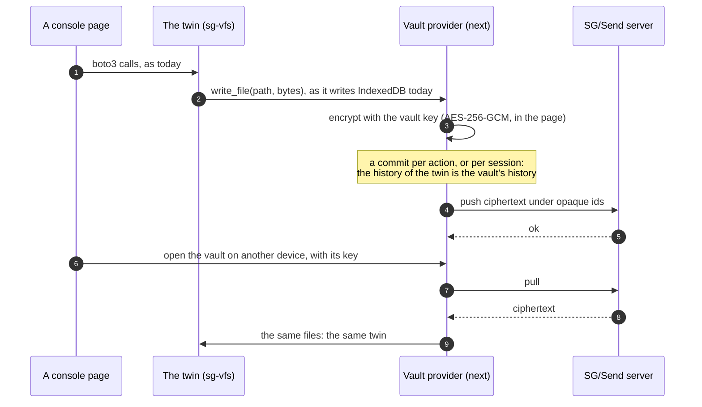

<!-- the markdown twin of https://aws.twin.sgit.ai/console/plan.html, generated from the same source by admin/build/pages.py; site v0.4.2; content CC BY 4.0 -->

[aws.twin.sgit.ai](../index.md) / [console](index.md) / plan

# The console: one page per service, every request in view, and the twin's state headed for a vault

The console is where the AWS twin is used rather than described: S3, Lambda and every other resource type, against the twin in the page or against an account, with a pane that shows every call and every request either way. This page says how it is built, what was decided and why, what is measured about which calls work where, and the plan for keeping the twin's state in an sgit vault.

The console. Each service is its own page, sharing one core: the mode (the twin or live), the region, and the request pane. Every button is a Python call; the twin's hook sends each request to the twin or to the account; the twin keeps its state in IndexedDB, shared by every page. Next, the same files in a vault.

The diagram's source (Mermaid)

## 1. A page per service

- **[Overview](index.md)**: a count per service, from the twin or the account, and the examples to start from.
- **[S3](s3.md)**: buckets, objects, upload, properties: the S3 browser, moved in.
- **[Lambda](lambda.md)**: functions per region, a scan of every region, and each function's configuration, environment (values hidden until asked), triggers, function URL, tags, code, a test invoke, logs and permissions.
- **[All resources](resources.md)**: any resource type, through the Cloud Control API.
- **[Calls](calls.md)**: which calls work from where, measured, and an editor for any operation.
- **[Twin data](twin.md)**: what the twin holds in this browser, file by file.

**The trade-off of separate pages**: each one starts Python again. The first visit downloads about 25 MB; after that the browser's cache serves the files, but Python still starts, installs the wheels and imports boto3 on every page: measured in headless Chromium here, 17 seconds for the first page and 15 for the next. That is too slow, and a faster start (the installed packages kept between pages) is the first thing on the list below. What makes the pages one console is that nothing important lives in the page: the twin's state is in IndexedDB, the mode and the session are in the tab, the region is remembered, so moving between pages loses nothing. The space and the addresses were worth it: every function, resource and call has a URL that can be bookmarked and shared.

## 2. Twin or live, top left

**Twin**: every call is answered by the Python twin in the page; nothing reaches AWS. **Live**: the same calls go to the account with the session pasted on [the sessions page](../sessions/index.md), signed in the page and sent from the browser, read-only unless writes are allowed. The choice holds across the console's pages for the tab. Live, the bar turns red.

## 3. The request pane

Open **Requests**, top right. One line per Python call, newest first: when, twin or live, the account and region, the call, how long, and ok or the error code. Open a call for the requests it made; open a request for its method, URL, headers and bodies as sent and as answered. The `Authorization` header is never kept; the session token is masked. Two buttons make the pane more than a log:

- **Replay in the call editor**: every request carries the boto3 call that made it (service, operation, parameters), so it can be sent again, changed, from [the editor](calls.md#/editor).
- **What would the twin answer?**: on a live read, the same request is sent to the twin and its answer shown beside AWS's. Where they differ, the twin is wrong, or holds different state: the beginning of measuring the twin against the account.

## 4. What works where, measured

The same AWS operation can be made from the AWS CLI, from boto3 in a normal Python, from boto3 in the browser under Pyodide, from the official AWS SDK for JavaScript in the browser, and from the twin. Outside a browser every call reaches AWS. In a browser, the answer is readable only when AWS sends CORS headers for the page's origin. [The calls page](calls.md) measures it, with invented keys so that no account is involved: 34 operations across 25 services, the CLI and boto3 columns recorded by `admin/build/call_matrix.py`, the two browser columns measured in whatever browser opens the page.

What it found, on 23 October 2026: the browser is blocked only for S3 (ListBuckets always; a bucket's own operations unless the bucket has a CORS rule), and the official JavaScript SDK is blocked exactly where boto3 under Pyodide is: CORS is the browser's rule, not a library's. Listing buckets therefore goes through the Cloud Control API, which answers any origin and, as Dinis found in CloudShell, returns every bucket in the account from any region.

## 5. The plan for the vault

The design this site started from is "AWS from the vault": the twin's backend is the user's vault. Today the twin's state is an sg-vfs file system kept in the browser's IndexedDB: a JSON document per bucket, function, role and rule, and the bytes of objects and code packages. That shape was chosen so that a vault could take its place without the twin changing.

The twin in a vault. The twin writes files as it does today; a vault provider encrypts them in the page with the vault key and commits them; the SG/Send server holds only ciphertext under opaque ids; on another device, the same vault, opened with its key, is the same twin.

The diagram's source (Mermaid)

| Step | What | Why it comes first |
|---|---|---|
| **1** | Export and import the twin's store as a folder of files (the layout above), from the Twin data page | Moves state between browsers and into an sgit working tree by hand, with no new trust |
| **2** | Open a vault read-only in the console, with its read key: its files become the twin | Read keys are publishable and one-way (sgit.ai); a shared estate to explore, safely |
| **3** | A vault provider for sg-vfs that writes: every change committed, encrypted in the page, pushed to SG/Send | The twin's history becomes the vault's: diff Monday against Friday, as the workflow page describes |
| **4** | Live reads written into the vault: the account, as last seen, kept as twin state | The twin becomes a versioned record of the account, and a starting point for rehearsal |
| **5** | The session itself in the vault, for its hour, instead of the tab | The design's original slot for credentials; it follows sgit's own key handling |

To check before step 3: which of sgit's HTTP routes a page may call (dev.send.sgraph.ai answers any origin today), how the vault key is held in a page, and what not to commit (large objects, code packages).

## 6. Next

- A faster start for each page: the installed Python packages kept between pages instead of installed again.
- Live verification of the Lambda page against a real account, then EventBridge, IAM and CloudWatch Logs as pages of their own.
- The twin-versus-live comparison as a report: every live read, compared, summarised.
- The vault, step 1 and step 2.

[← The console](index.md)[What works where →](calls.md)

---

*[This page as HTML](https://aws.twin.sgit.ai/console/plan.html) · [The site for agents](https://aws.twin.sgit.ai/llms.txt) · CC BY 4.0*
