<!-- the markdown twin of https://aws.twin.sgit.ai/how-it-works/index.html, generated from the same source by admin/build/pages.py; site v0.4.1; content CC BY 4.0 -->

[aws.twin.sgit.ai](../index.md) / how it works

# How it works: a live AWS session in a browser tab, step by step

When you paste a session, press **Go live** in the S3 browser and open a bucket, Python running inside the tab signs a request with your session, and either the browser sends it to AWS directly or a small program on your own machine passes it on. Nothing in between holds your secret key. This page takes each step in order: what runs where, which component makes which decision, what the browser allows and refuses, and what the local relay is and what it can see.

1 · the tab**Python loads**Pyodide, boto3, OSBot-AWS and the twin, unpacked in the page

2 · the session**You paste one**kept in this tab's sessionStorage, for its hour

3 · botocore**Signs the call**SigV4, in the tab, with the secret key

4 · the hook**Picks a route**twin, live or replay, per service

5 · the wire**Direct, or via the relay**the browser's fetch, or 127.0.0.1:4567

6 · the answer**Parsed and recorded**the same dict boto3 always returns, plus a traffic line

## 1. One hook, three routes

Everything starts from one decision, made in one place. The twin installs a hook inside botocore, the library under boto3 and OSBot-AWS, at the last point before a request leaves: after the request is built and **signed**, before it is sent. The hook reads which AWS service the request is for from its signature (the SigV4 credential scope, `Credential=AKID/20261021/eu-west-2/**s3**/aws4_request`), looks that service up in a route table, and sends the request one of three ways.


The three routes. The code above the hook is unchanged whichever is taken: boto3 and OSBot-AWS make the same calls against the twin and against the real account.

The diagram's source (Mermaid)

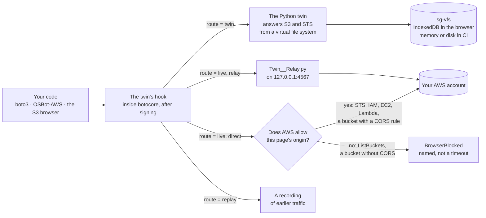

- **twin**: the Python twin answers, in AWS's own wire format, from a virtual file system. No network, no credentials. This is the default, and what CI uses.
- **live**: the request goes to AWS. In a browser, either **directly**, when AWS allows this page's origin, or **through the relay**, when it does not.
- **replay**: the answer comes from a recording of earlier traffic.

Hooking *after* signing is the choice everything else rests on. The twin sees exactly the bytes AWS would see, so its answers are tested against real requests; and a live request needs nothing added to it, so the twin never handles your secret key beyond what botocore already does.

## 2. Python in the tab

The S3 browser's buttons are JavaScript; everything behind them is Python. On first use the page loads [Pyodide](https://pyodide.org) 0.28.3 (CPython compiled to WebAssembly), installs pinned wheels from PyPI (boto3 1.43.116, osbot-utils 3.75.0, osbot-aws 2.39.10), and unpacks this site's `assets/py/aws_twin.zip`. About 25 MB the first time, then from the browser's cache. A button press becomes one call, `browser.call("list", {...})`, into [S3__Browser.py](https://github.com/SGit-AI/SGit-AI__Website__Twin__AWS/blob/dev/aws_twin/web/S3__Browser.py), which makes the same OSBot-AWS and boto3 calls a script on your laptop would.

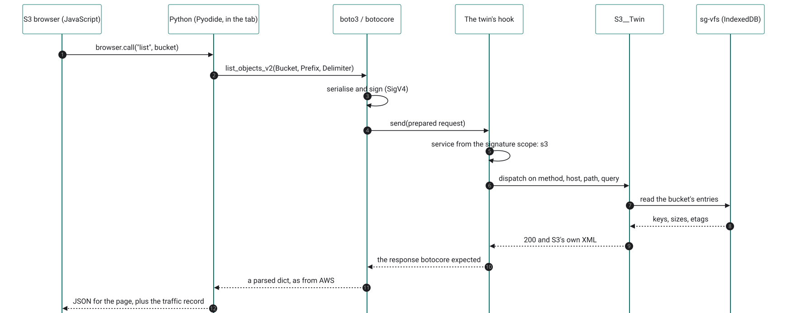

The twin route, end to end: a button press, a boto3 call, signing, the hook, S3__Twin reading sg-vfs (IndexedDB in the browser), and S3's own XML back to botocore, which parses it as if AWS had answered.

The diagram's source (Mermaid)

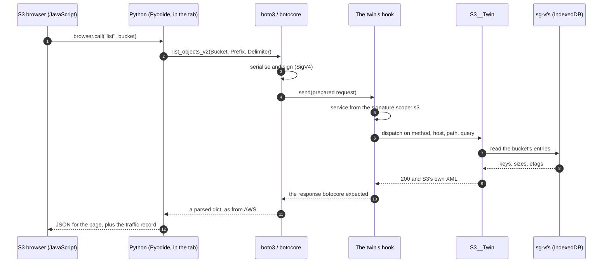

The same package runs under pytest in CI and in the page; one test suite runs in both ([run it here](../python/tests.md)).

## 3. Where the session lives

The session you paste on [the sessions page](../sessions/index.md) is kept in that tab's `sessionStorage` under `aws.twin/session`, with its expiry, and nowhere else: closing the tab removes it. **Go live** reads it from there (which is why it has to be the same tab), and hands it to Python, which sets it as the AWS environment variables of the Python inside the page and swaps the S3 browser's twin for one whose S3 and STS routes are `live`. Its first request is STS `GetCallerIdentity`, so the view can say which account and role it is now acting as. Live mode keeps nothing else, and nothing beyond the tab: the relay's address and the names of buckets you open by name, in the same sessionStorage. **Back to the twin** removes the session from Python again.

## 4. Live, directly: what the browser allows

In a normal Python, botocore opens its own sockets. A browser tab has no sockets, so the live route sends the already-signed request through the browser instead: Pyodide's urllib3 turns it into a synchronous `XMLHttpRequest` (botocore is synchronous Python, so the call has to block). The browser then applies its own rule, CORS: a page may read an answer from another origin only if that origin says so. Because the request carries `authorization` and `x-amz-*` headers, the browser first asks permission with an `OPTIONS` preflight.


Live, direct. Whether AWS answers the preflight decides everything. When it does not, the browser hides the answer and Python sees status 0; the twin turns that into a named BrowserBlocked error saying why and what would fix it, rather than a timeout that looks like an outage.

The diagram's source (Mermaid)

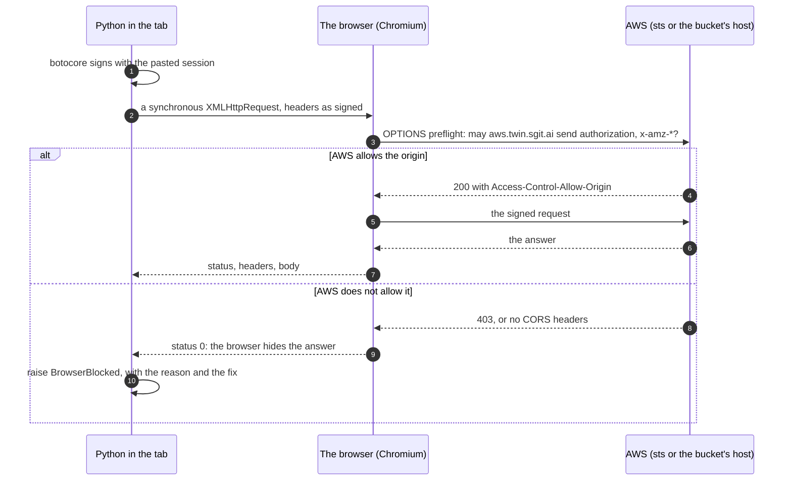

Measured on 21 October 2026, with a preflight from `https://aws.twin.sgit.ai`:

| Service | Answers a browser? | What that means here |
|---|---|---|
| STS, IAM, EC2, Lambda, CloudWatch Logs, Cost Explorer, CloudFormation | yes, any origin | Direct works. The sessions page's check is STS, direct. |
| S3, a bucket with a CORS rule for this site | yes, that bucket | Direct works for that bucket. [The rule, and how to add it](../iam/index.md#cors). |
| S3, a bucket without one | no | Relay, or add the rule. |
| S3 ListBuckets (the service endpoint) | never | Relay. There is no setting that changes this. |
| The access portal's credentials API | no | Why sessions are pasted rather than fetched ([measured](../sessions/index.md#better)). |

## 5. The local relay

The relay exists for the two "no" rows that matter to S3: listing buckets, and buckets without a CORS rule. It is one Python file, [Twin__Relay.py](https://github.com/SGit-AI/SGit-AI__Website__Twin__AWS/blob/dev/aws_twin/core/Twin__Relay.py), under 200 lines, standard library only, so it can be read in full before it is run:

```
curl -sO https://aws.twin.sgit.ai/aws_twin/core/Twin__Relay.py
less Twin__Relay.py                    # read it first
python3 Twin__Relay.py                 # http://127.0.0.1:4567, for https://aws.twin.sgit.ai only; Ctrl+C to stop
```

What it does is small. The page sends the signed request to the relay instead of to AWS, with the real AWS URL in an `x-twin-target` header. The relay checks two things, sends the request on to that URL unchanged, and returns AWS's answer with the CORS headers the browser wants. AWS checks the signature exactly as it would from anywhere else; to AWS the request simply comes from your machine.

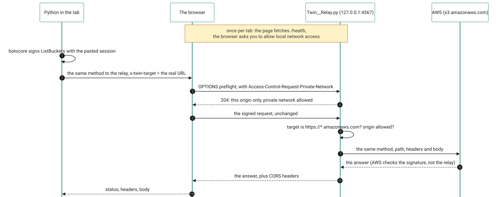

Through the relay. The browser asks once per tab whether this site may reach a service on your own machine; the page triggers that question with a plain request to /health before anything is signed.

The diagram's source (Mermaid)

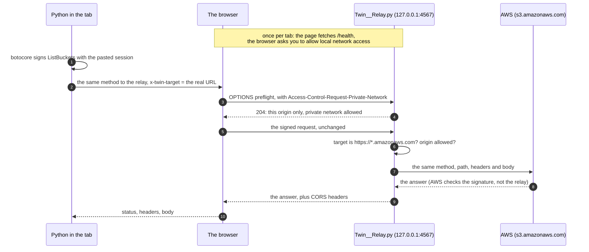

### Its rules

- **Only AWS, only HTTPS.** The target must match `https://…amazonaws.com`; anything else is refused with 400. It is not an open proxy.
- **Only this site.** It answers only requests whose `Origin` is `https://aws.twin.sgit.ai` (or origins you pass with `--origin`); others get 403 and no CORS headers.
- **Only this machine.** It listens on `127.0.0.1`, not on your network.
- **Nothing added, little kept.** It drops cookies, `Origin`, `Referer` and the browser's `sec-*` headers, forwards the rest as received, follows no redirects, and logs one line per request: method, host, path, status. Never a header or a body.
- **No credentials.** It has none to use, and its `/health` answer says so: `{"relay": "aws.twin", "forwards_to": "*.amazonaws.com", "holds_credentials": false}`. It uses `HTTPS_PROXY` if your machine needs one.

### What it can see, precisely


The secret access key stays in the tab: botocore uses it to compute one signature per request. What crosses to the relay, and to AWS, is the request, the access key id, the session token, and that signature.

The diagram's source (Mermaid)

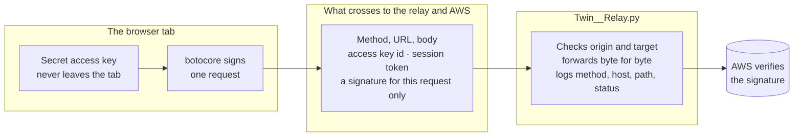

A signature is valid for one request (method, path, query, the signed headers, the body's hash) and only for a few minutes around its timestamp. So the relay can forward what you sent, and could resend that same request within that window, but it cannot make a different request: that needs the secret key, which it never sees. This is why it runs on your machine, from code you can read, rather than as a service somewhere. And the session itself expires within the hour.

### The browser's local-network prompt

Chromium now asks before a public website reaches a service on your own machine or network (Local Network Access): the first time the page contacts the relay, a permission prompt appears, and the request waits until it is answered. Allow it for `aws.twin.sgit.ai`. The relay's preflight answer carries `Access-Control-Allow-Private-Network: true`, the header the browser looks for. One detail mattered: a synchronous request, the kind botocore makes, cannot raise that prompt, and simply hangs. So **Go live** first sends an ordinary asynchronous `fetch` to `/health`; the prompt appears then, before any signed request, and a relay that is not running is reported by name (`RelayNotRunning`).

## 6. Read-only unless you say otherwise

A live session can do whatever its role allows. The S3 browser adds its own brake on top: in live mode, every operation that writes is refused before any request is made, unless **Allow writes** was ticked when you went live.


The read-only guard, in S3__Browser.call. A refused write shows as ReadOnly and never reaches AWS; with writes allowed, AWS's own answer, for example AccessDenied from a least-privilege role, is shown by its code.

The diagram's source (Mermaid)

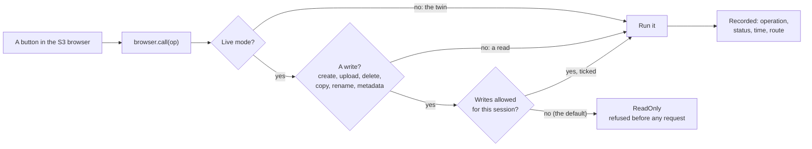

The other brake is the role. A session from a narrow permission set ([least privilege for the twin](../iam/index.md)) makes the twin's mistakes, and yours, small ones.

## 7. Every request recorded

Whatever the route, the hook records each request: the service and operation (`s3.ListObjectsV2`), the route (twin or live), the status, and the time taken. The S3 browser shows it under **Traffic**, and each log line says whether it was live. For live requests the twin still names the operation, by asking a throwaway twin to parse the request without answering it. The same records are what the replay route plays back: a recording of a live session becomes a test fixture that needs no account.

## 8. How this was checked

- **The whole live path, in a real browser, without an AWS account.** A headless Chromium test (Playwright) pastes a session; goes live directly, where real STS refuses the invented keys and the page says so by name; goes live through the relay; lists buckets, opens one, previews a file, is refused a delete in read-only mode, sees the signed calls in Traffic, opens a bucket by name, and goes back to the twin. Behind the relay, standing in for AWS, is the twin's own HTTP server. Ten checks, all passing.
- **The relay, under pytest**: its origin and target rules, its preflight, and boto3 through it (create a bucket, upload, download, list, a missing key, an upload without a content type) against the same stand-in. The requests arrive signed and unchanged. And the read-only guard: a delete refused with no request made, then let through once writes are allowed.
- **Real AWS, with invented keys** (opt-in, `AWS_TWIN_LIVE_TESTS=1`): STS GetCallerIdentity and S3 ListBuckets through the relay reach AWS and come back as `InvalidClientTokenId` and `InvalidAccessKeyId`: AWS read the signatures and rejected the keys, which is the round trip working.
- **A real session**: Dinis's own Identity Center session checked against AWS STS from the sessions page, account and role returned. Browsing a real account's buckets is the next thing to watch.

### Three bugs the stand-in caught

Each would have broken the first real use, and none shows up against the twin route alone:

1. **Uploads hung.** botocore sends some bodies with `Transfer-Encoding: chunked`; forwarded as is, with the body already whole, the far end waited for chunks that never came. The live path now drops the framing headers and lets the sender recompute them from the bytes.
2. **Uploads arrived empty.** Recording the request read its body stream to the end, and the request then went out with nothing left to send. The body is now read once and kept as bytes.
3. **Downloads failed with IncompleteRead.** Recording the response drained its stream before botocore read it. The live path now hands botocore a fresh response built from the recorded bytes.

## The files

| File | Does |
|---|---|
| [aws_twin/core/Twin.py](https://github.com/SGit-AI/SGit-AI__Website__Twin__AWS/blob/dev/aws_twin/core/Twin.py) | The hook, the route table, recording |
| [aws_twin/core/Twin__Browser_Http.py](https://github.com/SGit-AI/SGit-AI__Website__Twin__AWS/blob/dev/aws_twin/core/Twin__Browser_Http.py) | Sending a signed request from the browser, directly or to the relay; BrowserBlocked |
| [aws_twin/core/Twin__Relay.py](https://github.com/SGit-AI/SGit-AI__Website__Twin__AWS/blob/dev/aws_twin/core/Twin__Relay.py) | The relay |
| [aws_twin/web/S3__Browser.py](https://github.com/SGit-AI/SGit-AI__Website__Twin__AWS/blob/dev/aws_twin/web/S3__Browser.py) | The S3 browser's Python: every button, live mode, the read-only guard |
| [assets/s3/s3-browser.js](https://github.com/SGit-AI/SGit-AI__Website__Twin__AWS/blob/dev/assets/s3/s3-browser.js) | The S3 browser's page: views, the Live session form, the /health check |
| [tests/test_relay.py](https://github.com/SGit-AI/SGit-AI__Website__Twin__AWS/blob/dev/tests/test_relay.py) | The relay's tests |

The diagrams are Mermaid, rendered to SVG when the site is built (`admin/build/diagrams.js`), so this page loads no diagram script; each one's source is under it.

[← Least privilege for the twin](../iam/index.md)[The S3 browser →](../s3/index.md)

---

*[This page as HTML](https://aws.twin.sgit.ai/how-it-works/index.html) · [The site for agents](https://aws.twin.sgit.ai/llms.txt) · CC BY 4.0*
