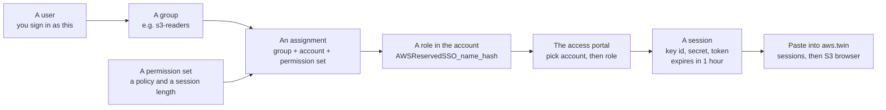

<!-- the markdown twin of https://aws.twin.sgit.ai/iam/index.html, generated from the same source by admin/build/pages.py; site v0.4.1; content CC BY 4.0 -->

[aws.twin.sgit.ai](../index.md) / iam

# Least privilege for the twin: stop signing in to do everything

The live S3 browser needs a session. It does not need an administrator's. This page sets up IAM Identity Center so that the session you paste every day can do one narrow thing: list bucket names and nothing more, read one bucket, read one folder, or read and write one bucket. The administrator role stays available for administration, behind its own sign-in. Every command below was run through the AWS CLI's own parameter checks before it was published, and every policy is a file you can read and download.

**The one idea.** In IAM Identity Center the power is not in the user you sign in as. It is in the **role you pick** in the access portal after signing in: each *permission set* assigned to you for an account shows up there as a role, and the session you copy carries that role's permissions and nothing else. So the fix has two halves: give yourself narrow permission sets and pick them by default, then move the administrator permission set to a separate sign-in so that a daily session cannot reach it.

## 1. The model, in one picture


IAM Identity Center: a user belongs to groups; an assignment joins a group, an account and a permission set; Identity Center creates a role in the account for it, named `AWSReservedSSO_<permission set>_<hash>`; the portal turns that role into a one-hour session; the session is what you paste here.

The diagram's source (Mermaid)



- **Users and groups** live in the identity store (the built-in directory, or an external IdP synced into it).
- **A permission set** is a template: one inline policy and/or AWS managed policies, plus a session length. Nothing exists in any account until it is assigned.
- **An assignment** is the triple *principal + account + permission set*. Assign to groups, not users: moving a person between groups is then the only thing you ever change.
- **The role** Identity Center creates in the account is named after the permission set. When you check a session on [the sessions page](../sessions/index.md), its ARN shows which one you picked: `arn:aws:sts::ACCOUNT:assumed-role/AWSReservedSSO_S3-Read-One-Bucket_…/you`.

## 2. Four recipes for S3

Each is an inline policy for a permission set. Replace `BUCKET_NAME` (and `FOLDER`) with yours; the commands in section 3 do that with `sed`.

| Permission set | Policy | Can | Cannot |
|---|---|---|---|
| **S3-List-Bucket-Names** | [s3-list-bucket-names.json](policies/s3-list-bucket-names.json) | See every bucket's name and region | List any bucket's contents, read any object, change anything |
| **S3-Read-One-Bucket** | [s3-read-one-bucket.json](policies/s3-read-one-bucket.json) | See bucket names; list and read every object in `BUCKET_NAME` | Open any other bucket; write, delete, or change the bucket |
| **S3-Read-One-Folder** | [s3-read-one-folder.json](policies/s3-read-one-folder.json) | See bucket names; list the bucket's top level and everything under `FOLDER/`; read objects under `FOLDER/` | List or read any other folder; write anything |
| **S3-Read-Write-One-Bucket** | [s3-read-write-one-bucket.json](policies/s3-read-write-one-bucket.json) | Everything in the read recipe, plus upload, overwrite, tag and delete objects in `BUCKET_NAME` | Delete or reconfigure the bucket itself (versioning, policy, CORS, encryption), touch any other bucket |

The list-only recipe is the one you asked for, written out:

```
{
  "Version": "2012-10-17",
  "Statement": [
    { "Sid": "SeeTheBucketNamesAndNothingElse",
      "Effect": "Allow",
      "Action": ["s3:ListAllMyBuckets", "s3:GetBucketLocation"],
      "Resource": "*" }
  ]
}
```

Notes that matter in practice:

- **Bucket-level and object-level actions take different ARNs.** `s3:ListBucket` is granted on `arn:aws:s3:::BUCKET_NAME`; `s3:GetObject` on `arn:aws:s3:::BUCKET_NAME/*`. Mixing them up is the most common reason a "read" policy reads nothing.
- **Hiding the other buckets' names**: drop the `SeeTheBucketNames` statement from the read recipes. The S3 browser then cannot list buckets, and you open yours by name instead (its **Open a bucket by name** form).
- **The folder recipe** follows AWS's own home-folder pattern: listing is allowed for the prefixes `""`, `FOLDER/` and `FOLDER/*`, so the bucket's top-level names are visible and nothing below another folder is. The S3 browser sends `prefix=` at a bucket's root, as the S3 console does, so the condition matches.
- **KMS-encrypted buckets** (SSE-KMS with your own key) also need `kms:Decrypt` on that key for reads, and `kms:GenerateDataKey` for writes. SSE-S3, the default, needs nothing more.
- **A bucket policy can still deny** what the permission set allows, and an SCP above the account can too. The simulator in section 4 does not see either.
- **The session check needs nothing.** STS `GetCallerIdentity` works with every permission set, so the sessions page can always say who you are.

## 3. Set it up from the CLI

Run this once, with the administrator role, from **AWS CloudShell** (the terminal icon in the console's top bar: already signed in, the AWS CLI installed) or from a terminal holding an administrator session. It needs the management account, or a delegated administrator for Identity Center, in **the region Identity Center is enabled in**.

```
# 0. where Identity Center lives, and what to work on
export AWS_REGION=eu-west-2                       # where Identity Center is enabled (its Settings page)
INSTANCE_ARN=$(aws sso-admin list-instances --query 'Instances[0].InstanceArn' --output text)
IDENTITY_STORE_ID=$(aws sso-admin list-instances --query 'Instances[0].IdentityStoreId' --output text)
ACCOUNT_ID=$(aws sts get-caller-identity --query Account --output text)
BUCKET=your-bucket-name
echo $INSTANCE_ARN $IDENTITY_STORE_ID $ACCOUNT_ID

# 1. the policies, from this site, with your bucket's name in them
curl -sO https://aws.twin.sgit.ai/iam/policies/s3-list-bucket-names.json
curl -s https://aws.twin.sgit.ai/iam/policies/s3-read-one-bucket.json | sed "s/BUCKET_NAME/$BUCKET/g" > s3-read-one-bucket.json
cat s3-read-one-bucket.json                       # read what you are about to grant

# 2. two permission sets, one-hour sessions
PS_LIST=$(aws sso-admin create-permission-set --instance-arn $INSTANCE_ARN --name S3-List-Bucket-Names \
            --description "See bucket names, not contents" --session-duration PT1H \
            --query 'PermissionSet.PermissionSetArn' --output text)
aws sso-admin put-inline-policy-to-permission-set --instance-arn $INSTANCE_ARN \
            --permission-set-arn $PS_LIST --inline-policy file://s3-list-bucket-names.json

PS_READ=$(aws sso-admin create-permission-set --instance-arn $INSTANCE_ARN --name S3-Read-One-Bucket \
            --description "Read one bucket" --session-duration PT1H \
            --query 'PermissionSet.PermissionSetArn' --output text)
aws sso-admin put-inline-policy-to-permission-set --instance-arn $INSTANCE_ARN \
            --permission-set-arn $PS_READ --inline-policy file://s3-read-one-bucket.json

# 3. a group per permission set; you (or a new daily user) in them
G_LIST=$(aws identitystore create-group --identity-store-id $IDENTITY_STORE_ID \
            --display-name s3-list-only --description "Can list bucket names" --query GroupId --output text)
G_READ=$(aws identitystore create-group --identity-store-id $IDENTITY_STORE_ID \
            --display-name s3-read-one-bucket --description "Can read one bucket" --query GroupId --output text)

#    an existing user, by user name ...
USER_ID=$(aws identitystore get-user-id --identity-store-id $IDENTITY_STORE_ID --query UserId --output text \
            --alternate-identifier '{"UniqueAttribute":{"AttributePath":"userName","AttributeValue":"YOUR_USER_NAME"}}')
#    ... or a new daily user (see section 5 for their first sign-in)
USER_ID=$(aws identitystore create-user --identity-store-id $IDENTITY_STORE_ID --user-name daily-user \
            --display-name "Daily User" --name GivenName=Daily,FamilyName=User \
            --emails Value=daily.user@example.com,Type=work,Primary=true --query UserId --output text)

aws identitystore create-group-membership --identity-store-id $IDENTITY_STORE_ID --group-id $G_LIST --member-id UserId=$USER_ID
aws identitystore create-group-membership --identity-store-id $IDENTITY_STORE_ID --group-id $G_READ --member-id UserId=$USER_ID

# 4. assign: group + account + permission set (this also creates the role in the account)
aws sso-admin create-account-assignment --instance-arn $INSTANCE_ARN --target-id $ACCOUNT_ID --target-type AWS_ACCOUNT \
            --permission-set-arn $PS_LIST --principal-type GROUP --principal-id $G_LIST
aws sso-admin create-account-assignment --instance-arn $INSTANCE_ARN --target-id $ACCOUNT_ID --target-type AWS_ACCOUNT \
            --permission-set-arn $PS_READ --principal-type GROUP --principal-id $G_READ
aws sso-admin list-account-assignment-creation-status --instance-arn $INSTANCE_ARN   # SUCCEEDED within seconds

# 5. later, after editing a permission set's policy: push the change to the accounts that have it
aws sso-admin put-inline-policy-to-permission-set --instance-arn $INSTANCE_ARN \
            --permission-set-arn $PS_READ --inline-policy file://s3-read-one-bucket.json
aws sso-admin provision-permission-set --instance-arn $INSTANCE_ARN \
            --permission-set-arn $PS_READ --target-type ALL_PROVISIONED_ACCOUNTS
```

The other two recipes are the same three steps with their files: `s3-read-one-folder.json` (also `sed "s/FOLDER/reports/g"`) and `s3-read-write-one-bucket.json`. To give a permission set an AWS managed policy instead, for example S3 read-only on every bucket:

```
PS_READ_ALL=$(aws sso-admin create-permission-set --instance-arn $INSTANCE_ARN --name S3-Read-All \
            --session-duration PT1H --query 'PermissionSet.PermissionSetArn' --output text)
aws sso-admin attach-managed-policy-to-permission-set --instance-arn $INSTANCE_ARN \
            --permission-set-arn $PS_READ_ALL --managed-policy-arn arn:aws:iam::aws:policy/AmazonS3ReadOnlyAccess
```

Seeing what exists:

```
aws sso-admin list-permission-sets --instance-arn $INSTANCE_ARN
aws sso-admin describe-permission-set --instance-arn $INSTANCE_ARN --permission-set-arn $PS_READ
aws sso-admin get-inline-policy-for-permission-set --instance-arn $INSTANCE_ARN --permission-set-arn $PS_READ
aws sso-admin list-account-assignments --instance-arn $INSTANCE_ARN --account-id $ACCOUNT_ID --permission-set-arn $PS_READ
aws identitystore list-users --identity-store-id $IDENTITY_STORE_ID
aws identitystore list-group-memberships --identity-store-id $IDENTITY_STORE_ID --group-id $G_READ
```

The console does the same under IAM Identity Center: **Permission sets** (Create permission set, Custom permission set, paste the JSON into the inline policy), **Groups**, and **AWS accounts** (select the account, Assign users or groups).

## 4. Test a policy before anyone has it

`iam simulate-custom-policy` evaluates a policy document against actions and resources without assigning it to anyone. It does not see bucket policies or SCPs, so it answers "does this policy allow it", which is the question while writing one.

```
aws iam simulate-custom-policy --policy-input-list file://s3-read-one-bucket.json \
    --action-names s3:ListAllMyBuckets s3:ListBucket s3:GetObject s3:PutObject \
    --resource-arns "arn:aws:s3:::$BUCKET" "arn:aws:s3:::$BUCKET/notes.txt" \
    --query "EvaluationResults[].[EvalActionName,EvalResourceName,EvalDecision]" --output table

# the folder recipe: the decision depends on the prefix asked for
aws iam simulate-custom-policy --policy-input-list file://s3-read-one-folder.json \
    --action-names s3:ListBucket --resource-arns "arn:aws:s3:::$BUCKET" \
    --context-entries ContextKeyName=s3:prefix,ContextKeyValues=other/,ContextKeyType=string \
    --query "EvaluationResults[].EvalDecision" --output text      # implicitDeny
```

The simulator pairs every action with every resource. For the read-one-bucket recipe expect `allowed` for ListAllMyBuckets (its resource is `*`), for ListBucket on the bucket and for GetObject on the object; `implicitDeny` for ListBucket on the object and GetObject on the bucket (the wrong ARN for each, which is the point of the check), and for PutObject everywhere.

## 5. A new user's first sign-in, and MFA

- **Users created from the CLI get no invitation.** In the IAM Identity Center console, open **Users**, the user, **Reset password**, and choose to send them an email with instructions (or generate a one-time password and hand it over yourself). Some consoles also offer, under Settings, Authentication, a setting to *send an email one-time password for users created from the API*; with it on, the first sign-in works without the reset.
- **Require MFA**: Settings, Authentication, Multi-factor authentication, Configure: prompt **every time they sign in**, allow authenticator apps and security keys or passkeys, and require users without a device to register one at sign-in.
- **Session length** is the permission set's: `PT1H` above. The access portal's own sign-in lasts longer (Settings, Authentication, Session duration); shorter is better there too.

## 6. Try it in the S3 browser

1. Sign in to the access portal as the narrow user (or as yourself), pick the account, and pick **S3-List-Bucket-Names**, not AdministratorAccess. Choose **Access keys** and copy any block.
2. Paste it on [the sessions page](../sessions/index.md) and press **Check it against AWS**. The ARN should name `AWSReservedSSO_S3-List-Bucket-Names_…`.
3. In the same tab, open [the S3 browser's Live session view](../s3/index.md#/live). To list buckets, start the relay ([what it is](../how-it-works/index.md#relay)) and tick **Use the local relay**; allow the browser's local-network prompt. Press **Go live**.
4. What each recipe should show:

| Permission set | Bucket list | Open a bucket | Open a file | Upload (writes ticked) |
|---|---|---|---|---|
| S3-List-Bucket-Names | every name | `AccessDenied` | n/a | `AccessDenied` |
| S3-Read-One-Bucket | every name | yours lists; the others `AccessDenied` | yes, in yours | `AccessDenied` |
| S3-Read-One-Folder | every name | top level, and inside `FOLDER/` | under `FOLDER/` only | `AccessDenied` |
| S3-Read-Write-One-Bucket | every name | yours | yes, in yours | yes, in yours |

Writes are refused by the S3 browser itself in live mode unless **Allow writes** is ticked, before any request is made, whatever the permission set says. A refusal from AWS shows as its own code, `AccessDenied`, which is the least-privilege setup working.

## 7. Without the relay: a CORS rule on the bucket

A browser can read an answer from a bucket only if the bucket has a CORS rule naming this site's origin. With one, the S3 browser reaches that bucket straight from the page, no relay. Listing all buckets still needs the relay: S3's ListBuckets endpoint has no CORS at all.

A CORS rule grants nothing. It only lets a page read the answers to requests the session's own policy already allows; an unsigned request, or a session without permission, still gets `AccessDenied`. Add it with the administrator role (it needs `s3:PutBucketCORS`, which no recipe above grants):

```
curl -sO https://aws.twin.sgit.ai/iam/policies/bucket-cors-for-aws-twin.json
aws s3api get-bucket-cors --bucket $BUCKET          # an existing rule? merge into it rather than replace it
aws s3api put-bucket-cors --bucket $BUCKET --cors-configuration file://bucket-cors-for-aws-twin.json
aws s3api get-bucket-cors --bucket $BUCKET
```

The rule: [bucket-cors-for-aws-twin.json](policies/bucket-cors-for-aws-twin.json), origin `https://aws.twin.sgit.ai` only, the methods the browser uses, and the response headers it needs to see (ETag, version id, region). Remove it with `aws s3api delete-bucket-cors --bucket $BUCKET`.

## 8. Move the administrator out of daily reach

The order matters; do not remove your own administrator access before the replacement is proven.

1. **Create a separate administrator user** (its own user name, and its own email address, for example a plus-address), with MFA, and a group `break-glass-admins` assigned **AdministratorAccess** on the account. Give that permission set a one-hour session too.
2. **Sign in as it once** in a private window and check that AdministratorAccess works.
3. **Remove AdministratorAccess from your daily user**, then sign out and back in to see only the narrow roles:

```
PS_ADMIN=arn:aws:sso:::permissionSet/…        # from: aws sso-admin list-permission-sets, then describe-permission-set
aws sso-admin list-account-assignments --instance-arn $INSTANCE_ARN --account-id $ACCOUNT_ID --permission-set-arn $PS_ADMIN
aws sso-admin delete-account-assignment --instance-arn $INSTANCE_ARN --target-id $ACCOUNT_ID --target-type AWS_ACCOUNT \
            --permission-set-arn $PS_ADMIN --principal-type USER --principal-id $USER_ID
```

- If the administrator access came through a group, remove the daily user from that group instead (`aws identitystore delete-group-membership`).
- The account's **root user** stays the last resort: MFA on, no access keys, password in a safe place. It can repair Identity Center if every administrator is locked out.
- Service users (for example ones used by Grafana) want their own narrow permission sets as well, scoped to what they read.

## How these commands were checked

Every command on this page was run through the AWS CLI (version 1.46) against the AWS twin's local endpoint (`python -m aws_twin`) with placeholder values. The CLI validates parameter names, shapes and required values before it sends anything, so a command with a wrong flag fails there; each of these reached the twin, which answered the S3 calls and returned `NotImplemented`, by name, for the Identity Center and IAM ones. The policy files are checked by the site's tests: valid JSON, version `2012-10-17`, placeholders present, and the CORS rule accepted by S3's `PutBucketCors` shape. What was not done is running them against a real organisation: AWS's own validation of the policy grammar happens in `put-inline-policy-to-permission-set`, and section 4 is how to catch a mistake before that.

[← AWS sessions](../sessions/index.md)[How it works →](../how-it-works/index.md)

---

*[This page as HTML](https://aws.twin.sgit.ai/iam/index.html) · [The site for agents](https://aws.twin.sgit.ai/llms.txt) · CC BY 4.0*
