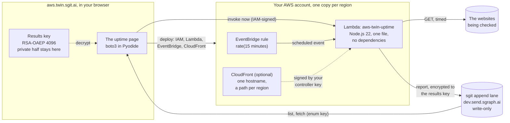
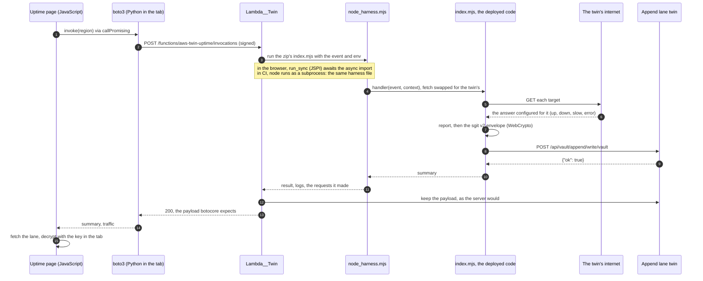

<!-- the markdown twin of https://aws.twin.sgit.ai/uptime/plan.html, generated from the same source by admin/build/pages.py; site v0.4.2; content CC BY 4.0 -->

[aws.twin.sgit.ai](../index.md) / [uptime](index.md) / plan

# The plan: an uptime check in every region, twin first, results only a vault can read

A Lambda function that checks whether websites are up, deployed to as many regions as you choose, run on a schedule or on demand, and sending each report encrypted to a vault's public key through an sgit append lane. Built against the twin first, so it can be deployed, invoked, broken and read back in this browser with no AWS account, and then deployed to a real one with the same boto3 code. This page is the plan, written before the code; [the uptime page](index.md) is the result.

The shape. The page deploys with boto3 from the browser, and can invoke a region on demand with the session's own IAM authority. Each region's function runs on an EventBridge schedule, checks the sites, encrypts a report to the results key, and appends it to a vault's lane, which only that key's owner can read. CloudFront is optional: one hostname in front of every region, for callers that sign requests with a controller key.

The diagram's source (Mermaid)

## 1. The language: Node.js 22, because of the cryptography

The brief asks for pure Python or pure Node.js with no dependencies. Checking a website is easy in both. Encrypting the report is not: sgit's envelope is RSA-OAEP with SHA-256, wrapping a fresh AES-256-GCM key, read from [sgit's PKI page](https://sgit.ai/docs/pki.md) and confirmed in the shipped CLI's source (`PKI__Crypto.hybrid_encrypt`, sgit-ai 0.24.0).

| Needed | Node.js 22 on Lambda | Python 3.13 on Lambda, standard library |
|---|---|---|
| RSA-OAEP (SHA-256), AES-256-GCM | WebCrypto, built in | not in the standard library |
| ECDSA P-256 verify (a controller's signed request) | WebCrypto, built in | not in the standard library |
| HTTP with a timeout | `fetch`, `AbortSignal.timeout` | `urllib` |
| The same file running in the browser's twin | yes: WebCrypto and `fetch` are the browser's own APIs | yes, but without the cryptography |

Python's ways round the gap are each worse than a dependency: `ctypes` into the runtime's OpenSSL (works on Lambda, not in a browser, and brittle across OpenSSL versions), AES and RSA written by hand (custom cryptography, which sgit's own rule forbids: "no custom primitives"), or a Lambda layer carrying `cryptography` (a dependency). Node.js has all of it in WebCrypto, the same API the browser has, so **one file** runs on Lambda, in CI, and inside the twin in this page, and its output is checked against sgit's own decryption.

Measured on 23 October 2026 before deciding: a synchronous Python function in Pyodide, which is what the twin's Invoke is, can wait for an async JavaScript function that uses WebCrypto, through `run_sync` and the browser's JSPI, when the page enters Python with `callPromising`. Chromium 141 has JSPI. So the twin runs the deployed JavaScript in the browser; in CI it runs it with `node`. The twin also runs Python handlers, in process, so the choice stays reversible.

## 2. The function

One file, `index.mjs`, about 200 lines, no imports at all.

- **Three ways in.** A **schedule** (an EventBridge rule, checks the configured targets); a direct **Invoke** (AWS has already checked the caller's IAM authority, so the event may name its own targets); and, optionally, a **function URL** whose requests must be signed by the **controller key**: an ECDSA P-256 public key in the function's configuration, the kind an sgit identity already has for signing. A request carries a timestamp and a signature over `timestamp + "\n" + body`, and is refused outside five minutes. The function never holds a private key.
- **The check.** A timed `GET` of each target, ten seconds at most, redirects followed: status, milliseconds, final URL, the error if it failed. Up means an answer below 400. At most 50 targets a call. Targets must be `http` or `https` and are refused when they name the machine itself or a private address, so a signed request cannot turn the function on its own runtime.
- **The report.** JSON: region, function, request id, when, the trigger, the results. Encrypted as sgit's envelope version 2: `{"v":2, "w": RSA-OAEP(aes key), "i": iv, "c": AES-256-GCM(report)}`, base64 of the JSON, which is what `sgit pki encrypt` writes.
- **The send.** `POST /api/vault/append/write/{vault_id}` with `{"append_token", "payload"}`, the payload base64 of the envelope text: encoded twice, as sgit's drainers expect. The answer is blind, `{"ok": true}`.
- **Its configuration**, in environment variables: the targets, the results public key (the `encrypt` PEM of an sgit bundle, or a PEM), the lane URL, the append token, the controller key. The append token is the one secret, and it is write-only: whoever reads it can add to the lane, not read it. Lambda's 4 KB limit on environment variables fits an RSA-4096 public key with room for targets.

## 3. The twins it needs

| Twin | Operations | Notes |
|---|---|---|
| **Lambda**, per region | CreateFunction, GetFunction, GetFunctionConfiguration, ListFunctions, UpdateFunctionCode, UpdateFunctionConfiguration, DeleteFunction, Invoke (RequestResponse, Event, DryRun, log tail), AddPermission, GetPolicy, RemovePermission, Create/Get/DeleteFunctionUrlConfig | Runs the deployed code: `nodejs*` through one harness file (node in CI, JSPI in the browser), `python*` in process. The function's outbound requests go to the twin's internet. |
| **IAM**, roles only | CreateRole, GetRole, DeleteRole, Attach/Detach/ListAttachedRolePolicies, Put/Get/Delete/ListRolePolicies | The execution role the function needs; nothing else of IAM. |
| **EventBridge**, per region | PutRule, DescribeRule, ListRules, Enable/DisableRule, DeleteRule, PutTargets, ListTargetsByRule, RemoveTargets | The twin can fire a rule on demand, which invokes its Lambda targets with a scheduled event. |
| **CloudFront**, the minimum | CreateDistribution, GetDistribution, GetDistributionConfig, ListDistributions, UpdateDistribution, DeleteDistribution | ETags and `If-Match` as CloudFront has them, disable-before-delete. Deployed at once rather than after minutes. |
| **The sgit append lane** | write, and the owner's list and fetch | Not AWS: the server the function posts to, twinned so a report can be read back and decrypted in the page. |
| **The internet** | an answer per target | Up, down (a status), slow, or unreachable, set in the page. A target with no answer configured fails, by name. |

One invocation in the twin. boto3's Invoke reaches the Lambda twin like any AWS call. The twin runs the deployed index.mjs through the harness, with fetch swapped for the twin's internet; the function encrypts its report with WebCrypto and posts it to the lane twin, which keeps it as the server would. The page then reads the lane and decrypts with the key that never left it.

The diagram's source (Mermaid)

## 4. The deployment, the same boto3 for the twin and the account

1. **An execution role**, `aws-twin-uptime-lambda`: trusted by `lambda.amazonaws.com`, with `AWSLambdaBasicExecutionRole` for its logs. Nothing else: the function calls no AWS API.
2. **In each region**: package `index.mjs` as a zip (in Python, in the page); create the function, or update its code and configuration; wait until it is active; put the EventBridge rule, its target, and the permission for `events.amazonaws.com` to invoke it.
3. **Optionally**, a function URL with its permission, and one CloudFront distribution with an origin per region and a path per region (`/eu-west-2/*`), caching off.
4. **Teardown**, the same steps backwards, so a test deploy leaves nothing behind.

A new IAM role takes seconds to become usable by Lambda; the first CreateFunction can be refused for that, and the page retries rather than blocking the browser.

## 5. Testing it from the page

- **Twin mode**, the default: choose regions and targets, set what the twin's internet answers for each, generate a results key in the browser (RSA-OAEP 4096, the private half never leaves the tab), deploy, invoke a region or fire the schedule, and read the decrypted reports.
- **Live mode**: the session pasted on [the sessions page](../sessions/index.md); the same deploy against the account; the reports go to a real append lane, and the page reads them back with the lane's enum key, which the append server allows from a browser. Every write is behind an explicit button.

## 6. Phases

| Phase | What | Done when |
|---|---|---|
| **1**, this release | The five twins, the function, the deploy code, the page, the tests: the function's envelope decrypted by sgit's own construction in CI | Deploy, invoke, fire and decrypt work in the twin, in CI and in the browser |
| **2** | The first live deploy to a test account and a test lane, one region, then several | A scheduled report from a real region arrives and decrypts |
| **3** | Function URLs and CloudFront live; the twin answering function URL and CloudFront hosts; signed reports; certificate expiry; content checks; the append token derived from the public key once sgit ships that | Each is measured live before it is claimed |

## 7. What to watch

- **Lanes fill up.** A lane holds 1,000 pending files per token. Every 15 minutes is 96 reports a day per region, so five regions fill a lane in two days unless reports are drained (fetched and marked processed). The page drains what it reads; a schedule is a choice of how often to read too.
- **The append routes are on dev.send.sgraph.ai only** (sgit.ai, checked 10 October 2026).
- **Reports are not signed yet.** The lane says who holds the token, not who wrote the report. A per-deployment signing key is phase 3.
- **Function URLs with no IAM auth are public endpoints.** The controller signature is the only gate, and AWS's rules for public function URLs have changed before: verify the permission set-up at first live use.
- **The twin's internet is configured, not measured.** What a site really answers from a region is what phase 2 is for.

[← How it works](../how-it-works/index.md)[The uptime page →](index.md)

---

*[This page as HTML](https://aws.twin.sgit.ai/uptime/plan.html) · [The site for agents](https://aws.twin.sgit.ai/llms.txt) · CC BY 4.0*
